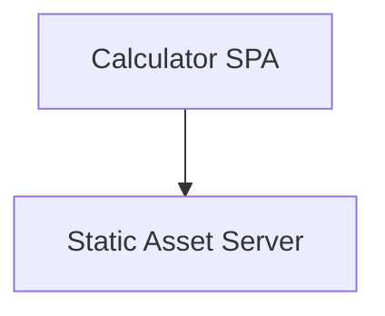
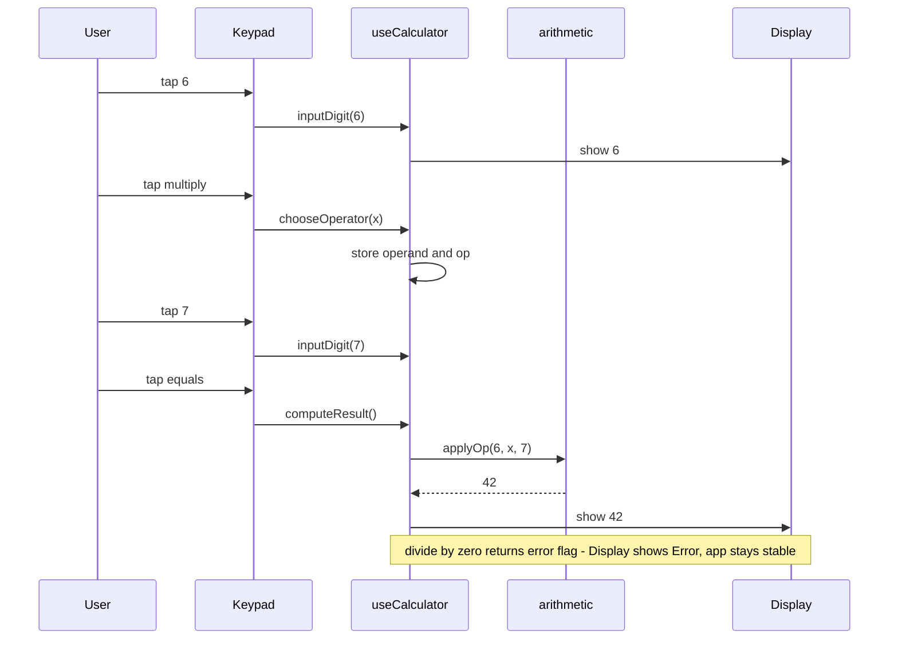
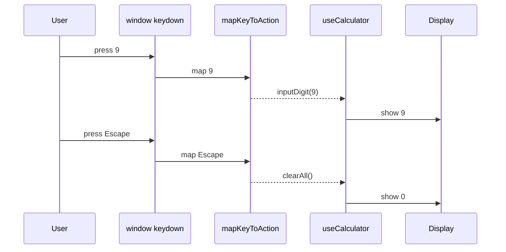
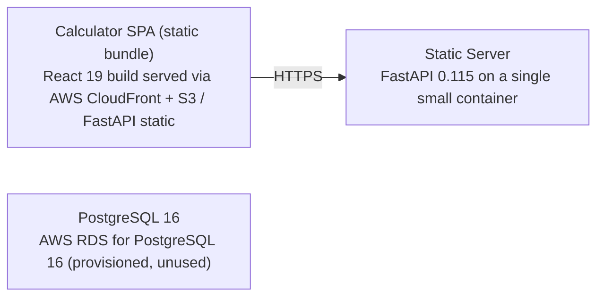

# Architecture

> Maintained by QuorQ AI SDLC. Text between `sdlc:auto` markers is regenerated; anything outside them is yours and is kept.

<!-- sdlc:auto:start narrative -->
## Overview

### ARCH-SUMMARY-1 · approved · source: architecture:summary

Approved architecture (version 3) defines a free, anonymous, single-page calculator running entirely in the browser, with a minimal backend only for serving static assets.

React 19 renders the responsive display and keypad and performs all arithmetic (four operations, decimal entry, chained calculations, sign toggle, clear/reset, divide-by-zero handling) entirely client-side. A minimal FastAPI 0.115 service serves the built static assets only -- no calculation or business logic runs server-side. No data is stored by the application; PostgreSQL 16 is provisioned per the approved stack but carries no schema in this version. Hosted on AWS for inexpensive, globally reachable static delivery.

**Related:** US-013

### ARCH-COMP-web_ui · approved · source: architecture:components.web_ui

Calculator SPA component built in React 19 owns all calculator rendering, input handling, and arithmetic logic.

Renders the responsive calculator UI, accepts both on-screen button and keyboard input, holds the calculation state, performs the arithmetic, formats the running result, and shows error states -- all client-side with nothing persisted.

**Related:** US-001, US-002, US-003, US-005, US-006, US-007, US-008, US-009

### ARCH-COMP-static_server · approved · source: architecture:components.static_server

Static Asset Server component (FastAPI 0.115) delivers the built SPA bundle over HTTPS and exposes a health check; it holds no calculation or business logic.

Serves the built single-page app (HTML, JS, CSS) to browsers over HTTPS. Explicitly carries no calculation or business logic, keeping the client-only design intact.

**Related:** US-013

### ARCH-PATH-chained-calc · approved · source: architecture:critical_paths.chained_calculation

Defines the chained-calculation critical path: build a number, pick an operator, build the next number, and request a result that carries forward.

User builds a number, picks an operator, builds another number and requests the result; the running result carries forward into the next operation. Divide-by-zero produces an error state instead of a number.

**Related:** US-003, US-005, US-006

### ARCH-PATH-keyboard-clear · approved · source: architecture:critical_paths.keyboard_and_clear

Defines the keyboard-input and clear/reset critical path, ensuring keyboard parity with on-screen buttons.

Keyboard keys map to the same actions as on-screen buttons. Enter or = computes the result; Escape or Delete clears all state, including any error state.

**Related:** US-007, US-008

### ARCH-EP-root · approved · source: architecture:endpoints

GET / serves the calculator single-page application and its static assets.

The root endpoint is the sole content-serving route of the static server, returning the built SPA (HTML, JS, CSS) for the browser to run client-side.

**Related:** US-013

### ARCH-EP-healthz · approved · source: architecture:endpoints

GET /healthz provides a liveness probe for the static server.

Used for infrastructure/orchestration health checking of the static server container; returns liveness status only, no application data.

### ARCH-DEPLOY-1 · approved · source: architecture:deployment_nodes

Three deployment nodes: the SPA static bundle on CloudFront+S3 (or FastAPI static), the FastAPI static server container, and a provisioned-but-unused PostgreSQL 16 RDS instance.

Calculator SPA (static bundle): React 19 build served via AWS CloudFront + S3 / FastAPI static, running in the browser on desktop and mobile. Static Server: FastAPI 0.115 on a single small container (Python 3.12 / Uvicorn). PostgreSQL 16: AWS RDS for PostgreSQL 16, provisioned but unused in this version.

**Related:** US-011, US-012, US-013

- ⚠ PostgreSQL 16 RDS node is provisioned but has no schema or current use -- confirm whether it should remain provisioned (cost) or be deferred until a feature needs persistence.

### ARCH-TECH-frontend · approved · source: architecture:technology_decisions.frontend

Frontend technology decision: React 19, chosen over Vue, Svelte, and Vanilla JS.

React 19 renders the interactive single-page calculator, holds calculation state in a reducer hook, and updates the display instantly on each tap or keypress. Responsive CSS adapts the keypad for desktop and mobile. Rationale cites NFR-003 (instant update) and NFR-002 (responsive layout).

**Related:** US-013

- ⚠ Rationale references NFR-002 and NFR-003, which are not present in the known requirement-key list provided -- confirm these NFR ids and add traceability once available.

### ARCH-TECH-backend · approved · source: architecture:technology_decisions.backend

Backend technology decision: FastAPI 0.115, chosen over static S3-only hosting or Nginx.

Serves the built SPA assets and a health endpoint. No calculation or data logic runs server-side, matching the client-only design required by US-013.

**Related:** US-013

### ARCH-TECH-database · approved · source: architecture:technology_decisions.database

Database technology decision: PostgreSQL 16, with no alternative needed since this version stores no data.

No data is stored or persisted in this version, so PostgreSQL carries no schema. It is named to satisfy the approved data layer and is the one to adopt if saved history or settings are added later. Rationale cites NFR-001 (no persistence in this version).

- ⚠ Rationale references NFR-001, which is not present in the known requirement-key list provided -- confirm this NFR id for traceability.
- ⚠ Database is provisioned with zero current schema/use; flagged for cost/scope review (see ARCH-DEPLOY-1).

### ARCH-TECH-cloud · approved · source: architecture:technology_decisions.cloud

Cloud technology decision: AWS, chosen over Vercel, Netlify, and Cloudflare Pages.

Delivers a responsive public page worldwide at low cost and scales to any number of anonymous visitors without managed machines. CloudFront caching keeps latency low globally.

**Related:** US-011, US-012
<!-- sdlc:auto:end narrative -->

<!-- sdlc:auto:start building-blocks -->
## Building Block View

| ID | Name | Technology | Responsibility | Depends on |
|---|---|---|---|---|
| web_ui | Calculator SPA | React 19 | Render the responsive calculator, accept on-screen button and keyboard input, hold the calculation state, perform the arithmetic, format the running result and show error states -- all client-side with nothing persisted. | static_server |
| static_server | Static Asset Server | FastAPI 0.115 | Serve the built single-page app (HTML, JS, CSS) to browsers over HTTPS. No calculation or business logic runs here. | — |

<!-- sdlc:auto:end building-blocks -->

<!-- sdlc:auto:start runtime -->
## Runtime View

### Perform a chained arithmetic calculation

User builds a number, picks an operator, builds another number and requests the result; the running result carries forward into the next operation, with divide-by-zero producing an error state instead of a number.

- **Components:** web_ui
- **Modules:** CalculatorApp, useCalculator (state reducer), engine/arithmetic, components/Display, components/Keypad
- **Key functions:** inputDigit(state, digit), inputDecimal(state), chooseOperator(state, op), computeResult(state), applyOp(a, op, b), toggleSign(state), clearAll(state), formatDisplay(value)

### Keyboard input and clear/reset

Keyboard keys map to the same actions as on-screen buttons; Enter or = computes, Escape or Delete clears all state including any error.

- **Components:** web_ui
- **Modules:** useKeyboard (window keydown listener), useCalculator (state reducer), components/Display
- **Key functions:** handleKeyDown(event), mapKeyToAction(key), dispatch(action), clearAll(state)

<!-- sdlc:auto:end runtime -->

<!-- sdlc:auto:start deployment-view -->
## Deployment View

| Name | Service | Runtime | Scaling | Environment |
|---|---|---|---|---|
| Calculator SPA (static bundle) | React 19 build served via AWS CloudFront + S3 / FastAPI static | Browser (desktop and mobile) | CDN edge caching, scales to public traffic automatically | dev |
| Static Server | FastAPI 0.115 on a single small container | Python 3.12 / Uvicorn | Single instance for dev; horizontally scalable behind a load balancer if needed | dev |
| PostgreSQL 16 | AWS RDS for PostgreSQL 16 (provisioned, unused) | PostgreSQL 16 | Single small instance; no schema in this version | dev |

| Source | Target | Protocol |
|---|---|---|
| Calculator SPA (static bundle) | Static Server | HTTPS |

<!-- sdlc:auto:end deployment-view -->

<!-- sdlc:auto:start decisions -->
## Architecture Decisions

| Layer | Choice | ADR |
|---|---|---|
| Frontend | React 19 | [ADR-0001](adr/frontend.md) |
| Backend | FastAPI 0.115 | [ADR-0002](adr/backend.md) |
| Database | PostgreSQL 16 | [ADR-0003](adr/database.md) |
| Cloud | AWS | [ADR-0004](adr/cloud.md) |
<!-- sdlc:auto:end decisions -->

<!-- sdlc:auto:start links -->
## Related Documents

- [Data Model](data-model.md)
- [API Specification](api/openapi.yaml)
- [Architecture Decision Records](adr/README.md)
<!-- sdlc:auto:end links -->
