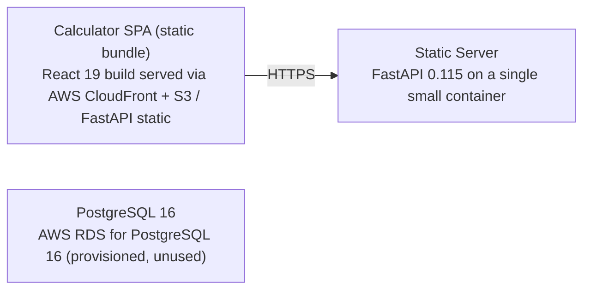

# Deployment Guide

> Maintained by QuorQ AI SDLC. Text between `sdlc:auto` markers is regenerated; anything outside them is yours and is kept.

<!-- sdlc:auto:start how-it-deploys -->
Pushes to `main` run `.github/workflows/deploy.yml`, which builds the API image (if there is a backend) and deploys the SPA to AWS Amplify. Commits touching only `docs/sdlc/**` don't deploy. Deployments can also be started from the platform's Deployment tab.
<!-- sdlc:auto:end how-it-deploys -->

<!-- sdlc:auto:start environments -->
| Name | Service | Runtime | Scaling | Environment |
|---|---|---|---|---|
| Calculator SPA (static bundle) | React 19 build served via AWS CloudFront + S3 / FastAPI static | Browser (desktop and mobile) | CDN edge caching, scales to public traffic automatically | dev |
| Static Server | FastAPI 0.115 on a single small container | Python 3.12 / Uvicorn | Single instance for dev; horizontally scalable behind a load balancer if needed | dev |
| PostgreSQL 16 | AWS RDS for PostgreSQL 16 (provisioned, unused) | PostgreSQL 16 | Single small instance; no schema in this version | dev |
<!-- sdlc:auto:end environments -->

<!-- sdlc:auto:start live -->
_Not deployed yet._
<!-- sdlc:auto:end live -->

<!-- sdlc:auto:start topology -->

<!-- sdlc:auto:end topology -->
